# Chamko — Platform Architecture

How the whole platform fits together, from a customer scanning a QR code to a post appearing on
Google. Diagrams are [Mermaid](https://mermaid.js.org/) and render directly on GitHub.

For setup and deploy steps see [`README.md`](README.md), [`docs/DEPLOY.md`](docs/DEPLOY.md) and
[`docs/GOOGLE_SETUP.md`](docs/GOOGLE_SETUP.md).

---

## 1. What Chamko does

Chamko is an autopilot for the **Google Business Profile** of Indian local businesses:

- **Daily Google posts** — AI writes the text, a design engine renders the image, and the post is
  published to Google on schedule.
- **Review replies** — every new review gets a reply in the reviewer's language, written in a
  natural owner's voice.
- **Profile kit** — description, services, keywords and FAQs built from the owner's own details.
- **Review QR** — a printed QR that opens the business's Google review box.
- **Growth tools** — rank checks, monthly reports, plan-expiry notifications.
- **10 languages** — English, Hindi, Gujarati, Marathi, Tamil, Telugu, Bengali, Kannada, Malayalam, Punjabi.

**Pricing:** one plan, ₹499 per business per 30 days, with a 4-day free trial the first time a
Google location is connected (`packages/shared/src/constants.ts`; the price is editable in the admin panel).

---

## 2. The big picture

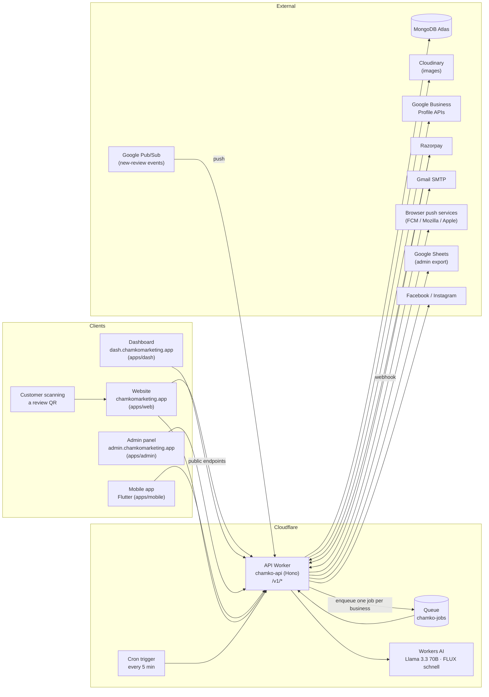

There is **one backend**: the `chamko-api` Cloudflare Worker. Everything else is either a static
front-end or an outside service. The Worker answers HTTP requests, runs the cron trigger, and
consumes its own queue.

---

## 3. Monorepo layout

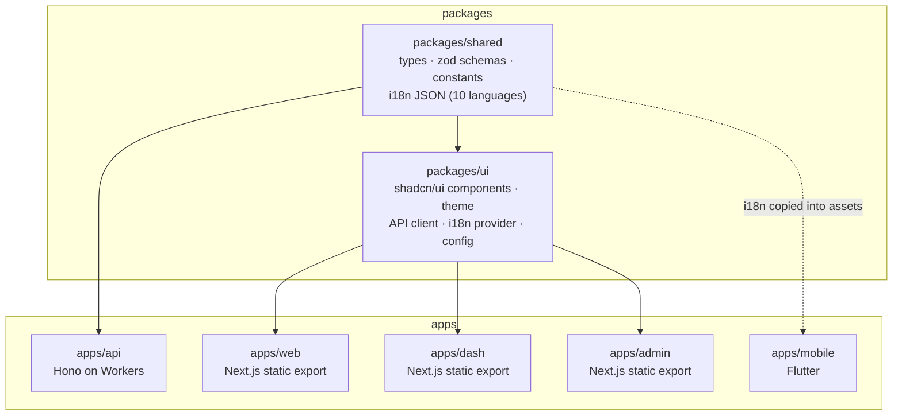

| Path | Role | Hosted on |
|---|---|---|
| `apps/api` | REST API, cron, queue consumer | Cloudflare Workers (`chamko-api`) |
| `apps/web` | Marketing site, ~4,700 guides, free tools, review-QR redirect page | Cloudflare Pages (`chamko-web`) |
| `apps/dash` | Owner dashboard (same features as the app) | Cloudflare Pages (`chamko-dash`) |
| `apps/admin` | Internal admin panel | Cloudflare Pages (`chamko-admin`) |
| `apps/mobile` | Android / iOS app | Play Store / App Store |
| `packages/shared` | Single source of truth for types, limits and all UI strings | — |
| `packages/ui` | Shared React design system and API client | — |

Tooling: **pnpm workspaces + Turborepo**, TypeScript everywhere except the Flutter app.

---

## 4. Inside the API Worker

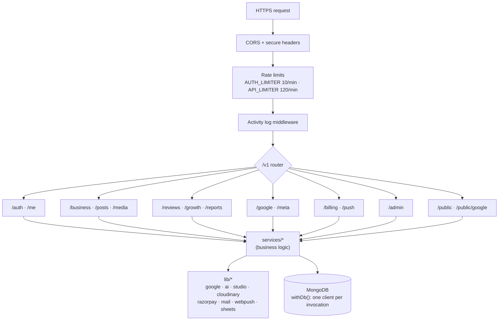

Code layout inside `apps/api/src`:

| Folder | Contains |
|---|---|
| `routes/` | One Hono router per area; validates input with zod and calls services |
| `services/` | Business logic: posts, reviews, billing, plan, push, rank, growth, settings… |
| `lib/` | Thin clients for outside systems, plus `ai/` (prompts + Workers AI) and `studio/` (image renderer) |
| `jobs/index.ts` | `schedule()` for the cron and `consume()` for the queue |
| `models.ts`, `lib/db.ts` | MongoDB document types and collections |

**Database rule:** each request, cron run or queue batch opens its own MongoDB client (`withDb`).
Workers cancel a request that touches another request's sockets, so clients are never shared.

### Main collections

| Collection | Holds |
|---|---|
| `users`, `admins` | Accounts, session version (sign out everywhere), admin access |
| `businesses` | Profile, Google connection (encrypted tokens), plan end date, autopilot settings, QR slug |
| `posts`, `media` | Daily posts (draft → scheduled → published) and uploaded photos |
| `reviews` | Google reviews and our replies |
| `payments`, `coupons`, `trials` | Razorpay orders and payments, discount codes, one-trial-per-location record |
| `push_subscriptions` | Browser push endpoints for plan reminders |
| `ai_cache`, `ai_usage`, `ai_meter`, `ai_accounts` | Cached AI results, daily limits, credit metering, extra AI accounts |
| `cloudinary_accounts` | Extra image-storage accounts (uploads move on as one fills up) |
| `settings`, `settings_history` | Admin-editable platform settings (deep-merged over defaults) and their history |
| `activity`, `snapshots`, `system`, `broadcasts` | Audit log, daily metric snapshots, system state, admin announcements |

---

## 5. Sign-in and connecting Google

New users sign up with Google in **one step**: sign-in and Business Profile access are granted together.

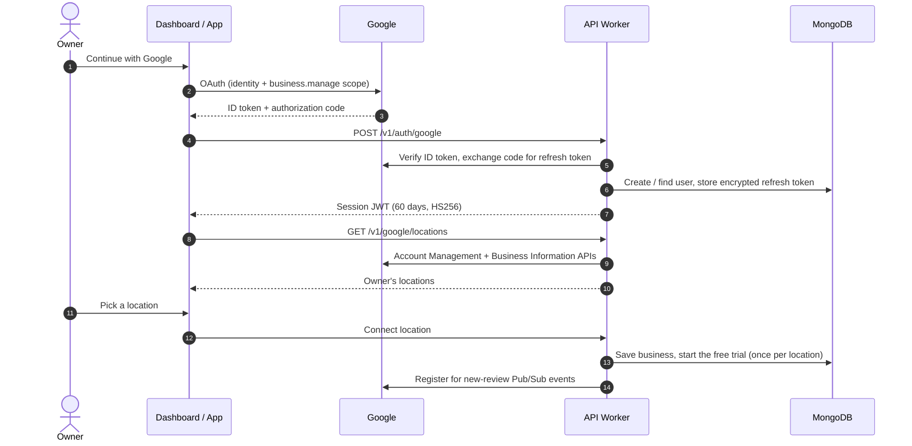

- Existing users can also sign in with an email OTP. New accounts must use Google.
- Bumping a user's `tokenVersion` invalidates every session on every device.
- Google tokens are encrypted at rest with `ENCRYPTION_KEY`.
- Admins sign in with Google **and** an authenticator code (TOTP), and every admin action is logged.

---

## 6. Automation: cron → queue → jobs

The cron fires **every 5 minutes**. It never does heavy work itself; it decides what is due and
enqueues **one message per business** on `chamko-jobs`. The queue consumer handles 5 messages at a
time and retries failures (up to 3 times, then a later sweep picks them up), so one broken
business never blocks the others.

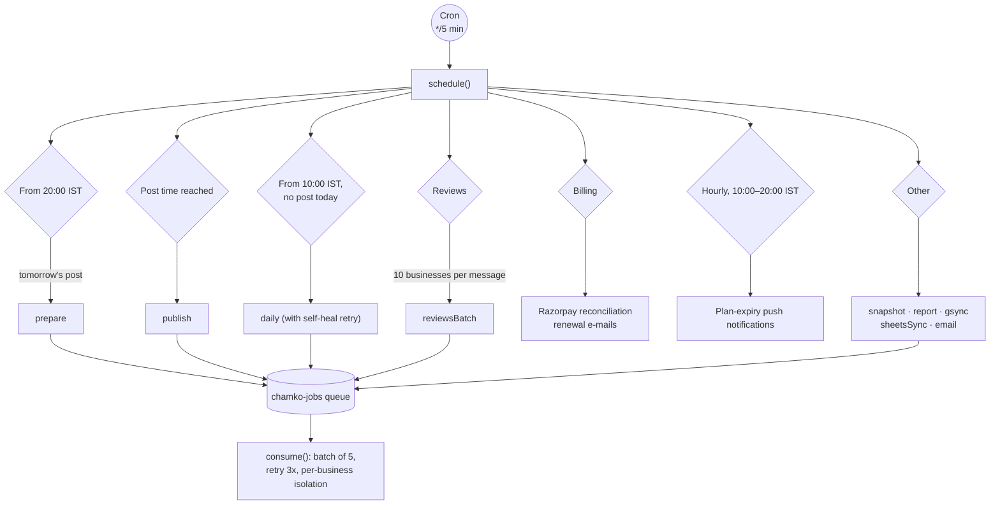

Only businesses with **their own active plan** (paid or trial) get automation. Admins can pause
any automation globally from the settings panel, for example during an AI outage.

---

## 7. The daily post pipeline

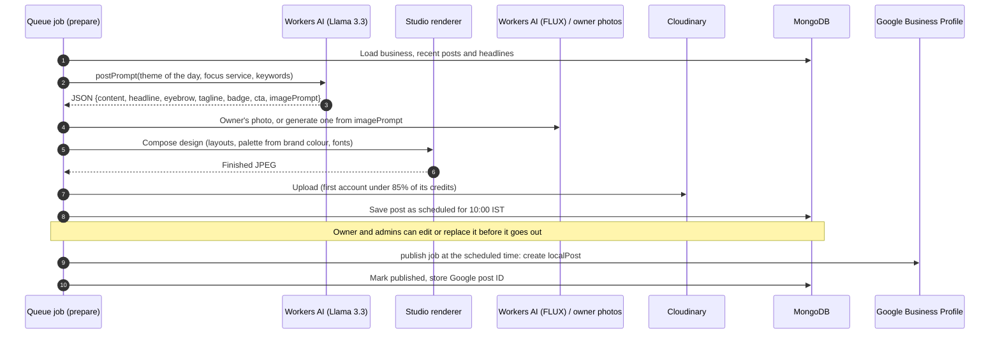

- Themes, headline styles and the focus service rotate by day and business, so posts don't repeat.
- Prompt rules forbid phone numbers, URLs, hashtags, ALL CAPS and invented offers, all of which
  Google rejects.
- **Without Google API access**, posts are still created; the owner copies them and taps
  "I posted it".

---

## 8. Reviews: arrival and reply

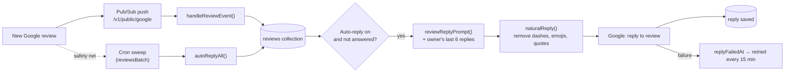

Replies follow the length and language of the review. They avoid template phrases and repeat
the owner's recent wording as little as possible. The shop name or a keyword appears only
occasionally, and never in replies to complaints. Owners can also edit or rewrite any reply from
the dashboard.

---

## 9. Review QR

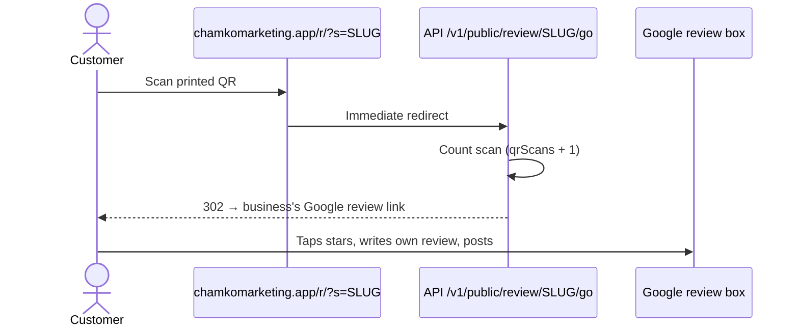

- The QR URL never changes, so printed codes keep working forever.
- The API only redirects to Google domains. If the stored link isn't a Google link, it opens a
  Google search for the business instead, so the endpoint can't be misused as an open redirect.
- Chamko never writes review text for customers; that would break Google's review policy.

---

## 10. Billing

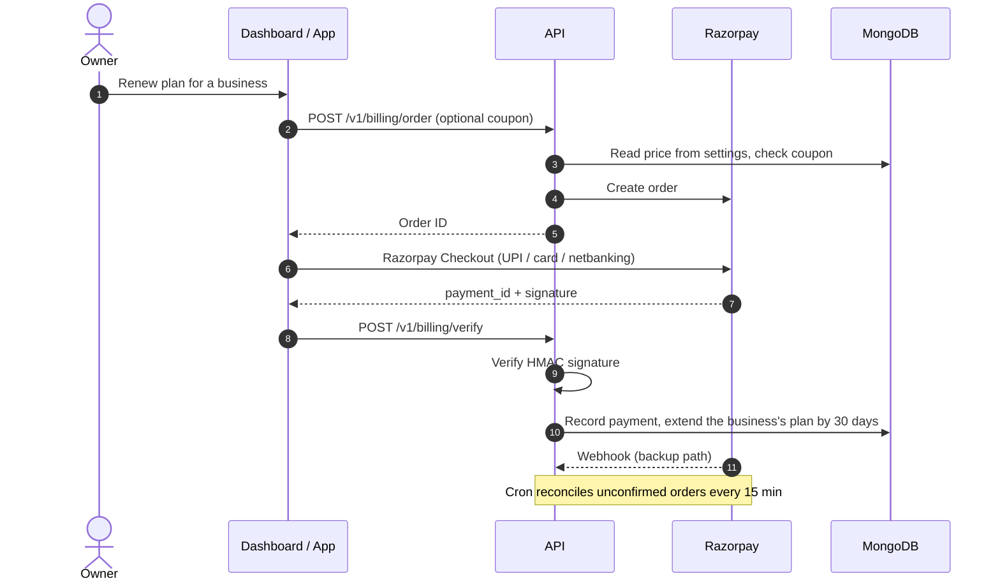

Each business has its own plan. We never see card or UPI details.

---

## 11. Plan-expiry push notifications

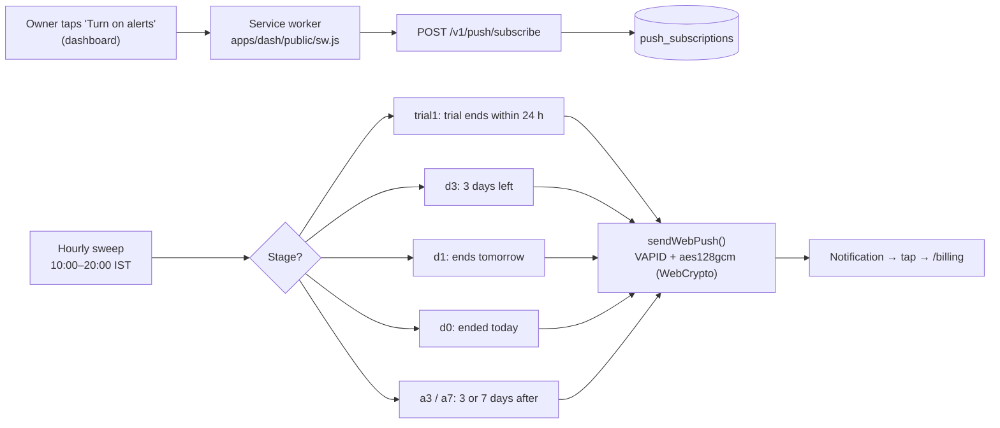

- Each stage fires at most once per plan period.
- Text is in the owner's language.
- Subscriptions that the push service reports as gone are deleted automatically.

Works on Android Chrome and desktop browsers, and on iPhone when the dashboard is added to the
Home Screen.

---

## 12. The marketing website and SEO

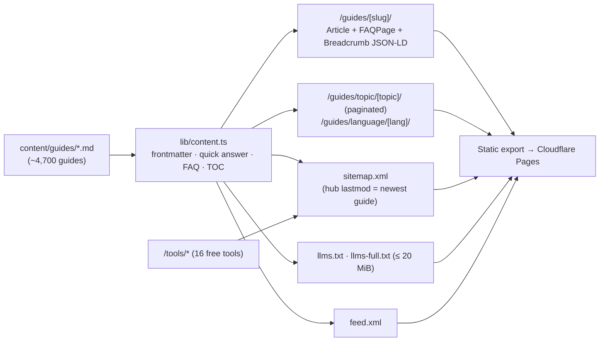

- **Guide format:** frontmatter (`title`, `description`, `category`, `date`, `keywords`, optional
  `lang`). The first blockquote becomes the "Quick answer", and `## Frequently asked questions`
  becomes FAQ structured data.
- **Related guides** are matched by weighted keywords, giving every page internal links.
- **Cloudflare Pages limits:** at most 20,000 files and 25 MiB per file. The deploy workflow
  removes the per-guide RSC `.txt` payloads and fails early if the file count is too high.
  `llms-full.txt` is capped at 20 MiB.
- `robots.txt` allows all crawlers, including AI assistants, and the `/r` QR page is `noindex`.

---

## 13. Front-end apps

| App | Main screens |
|---|---|
| Dashboard (`apps/dash`) | Home, Posts (all posts, published or not), Reviews, Photos, Profile, Growth, Billing (live plan, renew in the last 5 days), Settings, onboarding, printable poster and receipts |
| Admin (`apps/admin`) | Users, businesses, payments, coupons, posts, AI and Cloudinary credit accounts, platform settings (price, feature switches), broadcasts, health, activity log, team |
| Mobile (`apps/mobile`) | Same feature set as the dashboard (`features/auth, home, posts, reviews, photos, profile, billing, settings`) |

All three web apps are Next.js **static exports**, so there is no server rendering at runtime. They
call the API through the shared client in `packages/ui`. Strings come from `packages/shared/src/i18n`.
`en.json` is the source, and `pnpm i18n:translate` fills the other nine languages.

---

## 14. AI and image infrastructure

```mermaid
flowchart LR
  CALL["generateJson / generateImage"] --> FO["runWithFailover()"]
  FO --> ACC1["Main Cloudflare account"]
  FO -- "credit used up / error" --> ACC2["Extra accounts<br/>(ai_accounts, added in admin)"]
  CALL --> CACHE[("ai_cache")]
  CALL --> LIMIT[("ai_usage: per-business daily limit")]
  UP["uploadImage()"] --> CA1["Main Cloudinary"]
  UP -- "≥ 85% of monthly credits" --> CA2["Extra Cloudinary accounts"]
```

- Every prompt is a short role plus numbered hard rules, the facts it may use, and a **JSON
  schema**, so output is always parseable. Rule 1 everywhere is "never invent facts".
- Results are cached, and owner-triggered AI actions count against a daily per-business limit.
  Autopilot runs are metered but never blocked.

---

## 15. Build and deploy

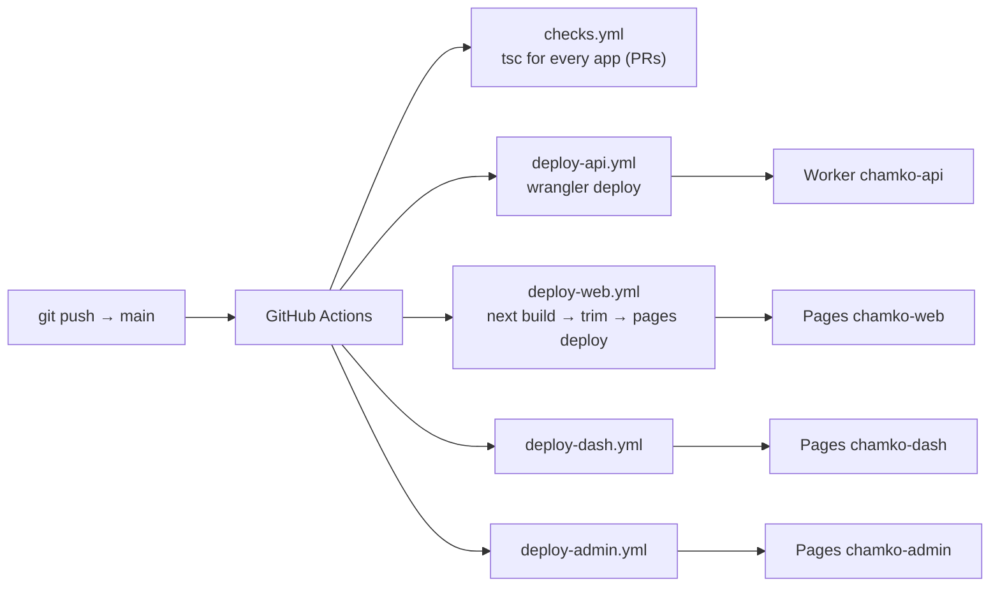

- Nothing is built on a laptop. Pushing to `main` deploys whatever changed.
- Each workflow runs only when its app or the shared packages change. A newer push cancels a web
  build that is still running.
- **Secrets** (`MONGODB_URI`, `JWT_SECRET`, `ENCRYPTION_KEY`, Razorpay, Cloudinary, Google, Meta,
  mail and `VAPID_PRIVATE_KEY`) live only in Cloudflare Worker secrets. They are never stored in the
  repo or in GitHub. Public values (URLs, model names, client IDs, the VAPID public key) are
  `vars` in `apps/api/wrangler.jsonc`.
- Local checks: `tsc --noEmit` per app and `wrangler deploy --dry-run` for the API.

---

## 16. Safety and policy guard-rails

| Area | Guard-rail |
|---|---|
| Google posts | No phone numbers, URLs, hashtags, ALL CAPS or invented offers; one post per business per day |
| Review replies | Natural owner voice, no keyword stuffing, no personal details, calm replies to complaints |
| Reviews | Chamko never writes reviews for customers; the QR goes straight to Google |
| Review requests | The WhatsApp message asks for an honest review and never offers anything in return |
| Google data | Used only to run the service (Google API Services User Data Policy, Limited Use); tokens encrypted |
| Accounts | Deleting an account removes businesses, posts, reviews, media, drafts and push subscriptions |
| API | Rate limits, secure headers, zod validation, redirects only to Google domains, admin TOTP + audit log |
